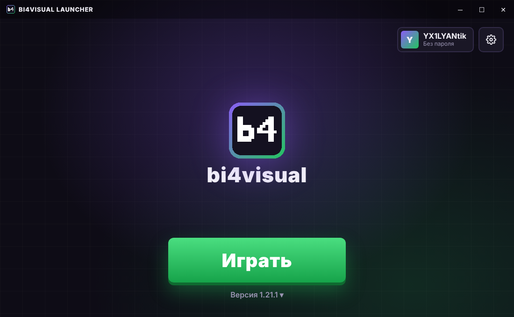

# bi4visual launcher

Лаунчер Minecraft: Java Edition. Одна большая кнопка «Играть», остальное — в настройках.



## Что умеет

- Любая версия Minecraft с серверов Mojang (релизы, по желанию снапшоты и старые).
- Fabric в один клик для любого релиза.
- Аккаунты: без пароля по нику или вход через Microsoft (лицензия).
- Сам скачивает нужную Java (Eclipse Temurin 8, 17 или 21).
- Настройки памяти, размера окна, папки игры и аргументов JVM.
- Журнал игры, если она закрылась с ошибкой.

## Сборка

Нужны [Rust](https://rustup.rs), [Bun](https://bun.sh) и [зависимости Tauri](https://tauri.app/start/prerequisites/).

```sh
bun install
bun run tauri dev      # запуск для разработки
bun run tauri build    # установщик в target/release/bundle
cargo test -p bi4visual-core
```

Готовые сборки для Windows, macOS и Linux собирает GitHub Actions при каждом пуше
(вкладка Actions → Artifacts). Для тега `v*` создаётся черновик релиза.

### Вход через Microsoft

Чтобы работал вход с лицензией, нужен свой Client ID:

1. Зарегистрируйте приложение в [Azure Portal](https://portal.azure.com) → App registrations,
   тип аккаунтов «Personal Microsoft accounts only», включите «Allow public client flows».
2. Подайте заявку Mojang на доступ к Minecraft API:
   <https://aka.ms/mce-reviewappid>. Без одобрения вход вернёт ошибку.
3. Задайте ID при сборке: переменная окружения `BI4VISUAL_MS_CLIENT_ID`
   (в GitHub — секрет репозитория с тем же именем).

Без ID лаунчер работает только с аккаунтами по нику.

## Устройство

- `core/` — вся логика без интерфейса: список версий, загрузка файлов с проверкой SHA-1,
  библиотеки и natives, ресурсы, Fabric, Java, аккаунты, сборка командной строки.
- `src-tauri/` — оболочка Tauri: команды и события для интерфейса, запуск процесса игры.
- `src/` — интерфейс на React.

Данные хранятся в `%APPDATA%\bi4visual-launcher` (Windows),
`~/Library/Application Support/bi4visual-launcher` (macOS) или `~/.local/share/bi4visual-launcher` (Linux).

Minecraft — товарный знак Mojang Synergies AB / Microsoft. Проект с ними не связан.
